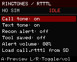
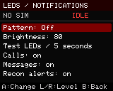
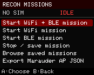

# HackerPhone + Hacker Band

Independent MIT firmware for the owner's CircuitMess **MakerPhone 2 / MP24 engineering sample**, maintained in its own [HackerPhone repository](https://github.com/valleytechsolutions/HackerPhone). This is an early hardware bring-up, not a finished Marauder port or a validated daily-use telephone. A web flasher will follow hardware and recovery validation; none is published yet.

**Hacker Band development has started in this same repository** for the owner's
ESP32-C3 Maker Band. The first milestone provides tested portable clock,
stopwatch, notification, Matrix rain animation and separate ignore/decline state,
plus a versioned companion packet envelope and a compile-only C3 target.
These modules are not yet connected to a band display, RTC or Bluetooth service.
There is no flashable Maker Band release yet. See the
[Hacker Band implementation status and pairing design](docs/HACKERBAND.md).

The intended pair is a watch-first wrist companion and a phone that handles
cellular service and detailed recon. The band will show calls and texts, sync
its RTC from the phone, and share evidence-labelled nearby-device observations.
**Ignore** will silence the band while the phone keeps ringing; **Decline** will
request rejection of that specific incoming call. One future web flasher will
offer separate, hardware-checked HackerPhone and Hacker Band releases.

The original 4 MB flash has been saved privately before any replacement. This board has an ESP32-S3, 2 MB quad PSRAM, a 160×128 ST7735 panel, 23 keys, a Quectel EG91-NAX modem, and a working SD card under its original firmware. Original Ringo firmware targets different hardware.

 

Actual 160×128 framebuffer captures from the engineering sample, displayed at 2× size.

## Current engineering build: 0.6 preview

The 0.5 foundation provides an SD MP3 player, retro RTTTL notifications, side volume controls,
keypad lock/power-off handling and eight configurable notification LEDs. It also adds
recon missions, editable SSID lists, Marauder AP JSON interchange, marked target lists,
radio MAC settings and an SD file manager. See [daily controls and audio](docs/DAILY-USE.md)
and [toolkit workflows](docs/TOOLKIT.md).

  

- Nonblocking, bounded phone service: SIM and registration status, incoming call events, validated dial commands, SMS-submit encoding, command timeouts, and no automatic message retries.
- No-SIM is a normal idle state; it never causes a modem power-cycle loop.
- Native phone-service tests use synthetic UART transcripts. No real calls or SMS are transmitted by tests.
- BWM boot image and VTS home wallpaper use the owner's unchanged PNG originals.
- Physical keypad navigation, multi-tap text composition, passive Wi-Fi/BLE recon, RSSI hunt, CSV session logging, and SD file previews are in the engineering application.
- Four saved themes: VTS Red, Dragon, Green Radar, and Black & Gold. The home title is **HACKERPHONE**. Device-family colors stay consistent across themes.
- Security menu: radar, Wi-Fi access points, transmitting stations, probe requests, BLE devices, dwell-normalized channel observations, and disconnect/BLE-spam/SSID-conflict events. Wi-Fi-only, BLE-only, combined listening and channel lock are selectable.
- Buffered raw Wi-Fi or EAPOL-only PCAP recording to SD, with short-write/error handling and a read-only USB file exporter. See [toolkit controls](docs/TOOLKIT.md) for limits and timestamp meaning.
- Independently implemented BLE GATT discovery, reads, writes, subscriptions, notifications and tree export. Device connection requires selecting a live BLE target; characteristic writes use the USB console. Blocking BLE requests run in a separate worker so the keypad and modem continue to be serviced.
- Timed Wi-Fi/BLE beacon sessions and complete legacy BLE advertisement replay. Optional identity replay supports random BLE addresses only. Each session shows its state, stops after 15 seconds and can be stopped immediately. Ordinary advertisement replay uses this radio's address; neither replay mode clones GATT services or pairing keys.
- Expanded Wi-Fi/BLE attack menu with target review, bounded duration/rate, stop controls and driver-error reporting. New packet builders cover deauth/disassociation, authentication, EAPOL, sleep, SAE-commit, CSA/quiet and pairing-advert variants. These are experimental implementations; a single authentication request passed the driver check, but no peer response was observed. See [scope and validation limits](docs/MARAUDER-SCOPE.md).
- **Infrared** home app: record a raw remote signal, transmit the selected signal once, save it to SD, and browse `.ir` libraries one button at a time. Large libraries remain on the card. [IR controls, formats and current limits](docs/INFRARED.md).
- Optional SD vendor lookup at `/hackerphone/oui.bin`, generated with the original MIT [database builder](tools/build_vendor_db.py). No ChimeraBLE database or GPL application code is included. Random/private BLE addresses are not assigned an OUI vendor.
- Dragon Detector's bounded parsers and signal filter are pinned to its 0.9.2 source. A device signature is evidence of a device family, not proof of malicious intent. RSSI is not a measured range or bearing.
- **22 dedicated scanners** with AP security/WPS/PMF details, AP/client mapping, packet graphs, a handshake summary, selected-AP captures and Remote ID detail pages. Passive BLE is the default; optional active scanning requests additional advertised names.
- **24 Wi-Fi/BLE transmission modes**, manual targets and 16-entry AP/client lists. Captured-beacon cloning preserves security information; SAE supports group-19 anti-clogging token retries. These are experimental capabilities, not a claim that every peer is affected.
- **Connected network tools:** saved Wi-Fi profile, ping/ARP/TCP scans, hotspot and a local SD-backed captive portal. Saved observations reload as stale, and saved SSIDs can become a streamed beacon playlist.
- **Tracker controls:** AirTag, Find My and DULT sound requests; a separately reviewed, timed Find My live sweep; legacy random-address replay. Sound writes are verified against an owned laptop fixture, not an audible tracker.
- The [94-mode Marauder mapping](docs/MARAUDER-SCOPE.md) records implemented paths, experimental subsets and missing capabilities, plus auxiliary workflows. GPS-dependent modes, OTA/SD self-updates, SPIFFS restore, peer-effect validation, long-duration cellular validation and SMS inbox remain open. Live dial/answer/hangup and a PCM voice bridge are available in the 0.6 engineering preview; the owner confirmed two-way call audio.

## 0.6 cellular preview

Mint LTE registration and internet access are now measured on this sample,
with two-way call audio confirmed using the corrected 16 kHz PCM bridge.
Settings / Cellular / 4G hotspot can share that connection over a password-protected
Wi-Fi network. A laptop completed DHCP, cellular DNS and HTTP traffic through it.
See [cellular setup and controls](docs/CELLULAR.md). The 64 GB SD card mounts and
passes a write/read check; directory loading is incremental and text previews page
through files. Imported RTTTL supports up to 1,024 notes and ten minutes.

## Build and test

Use Python 3.12 in a virtual environment and install `python -m pip install -r requirements-dev.txt`. This includes **pioarduino Core 6.2.0**, required by the pinned ESP32 platform; it provides the `platformio` Python module and `pio` command. The recipe also pins TFT_eSPI and NimBLE. `python tools/test_core.py` runs native tests without opening a serial port. `python -m platformio run -e mp24_sample` builds the engineering image.

`python -m platformio run -e hackerband_core` compiles the portable watch services
for ESP32-C3. This target intentionally has no peripheral pin assignments and
blocks PlatformIO upload/erase targets until the actual Maker Band hardware and
recovery procedure are established. Do not manually flash its generated image.

The partition file matches this sample's saved layout. Development flashing must write **only the application at `0x10000`**, after verifying the connected chip, flash size, and recovery copy. Never use Ringo binaries, erase-flash, or the automatically generated `firmware.factory.bin` on this sample: its generic boot-app offset overlaps the saved NVS layout. The development procedure preserves the bootloader, partition table, NVS and SPIFFS. Normal runtime may update radio calibration/NVS and crash diagnostics. SD logging creates files only inside `/hackerphone`; no formatting is performed.

## Repository layout

| Directory | Contents |
|---|---|
| `firmware/` | Phone services and the initial portable Hacker Band core |
| `assets/` | Owner-supplied BWM boot and VTS wallpaper originals |
| `tools/` | Native test runner, asset conversion, vendor database builder and USB exporter |
| `tests/` | Synthetic phone, protocol, storage and tracking checks |
| `docs/` | Hardware evidence, toolkit controls, feature inventory and validation results |
| `third_party/` | Pinned detector/decoder sources and license notices |

Local recovery images, captures and toolchains are excluded from Git. CI checks native services and compiles the engineering application; it does not flash hardware or publish a factory image.

## Controls

Joystick or A opens a menu item; C returns home and ends active transmissions/GATT connections; B goes back or erases text. Phone number entry uses the numeric keys and `*` for a leading `+`. Messages use traditional multi-tap typing (800 ms between different letters on one key), followed by a review screen. Radar's D button pauses listening. Target details lead to a signal hunt; D opens evidence, raw advertisement, connection and replay tools. A target being viewed is pinned against table eviction so a menu action cannot silently select its replacement. The SD browser loads 32 entries per page incrementally; Left/Right moves between directory pages or 168-byte text-preview pages.

Side volume buttons adjust master audio. The red side button taps to lock/unlock and holds for 2.5 seconds to begin shutdown; release it to finish. Music has play/pause, next/previous, stop and repeat controls. [Daily-use controls](docs/DAILY-USE.md) describe saved tones, LED patterns, SD uploads and verification limits.

USB diagnostics and tools are documented in [TOOLKIT.md](docs/TOOLKIT.md). Explicit `PHONE DIAL`, `PHONE ANSWER` and `PHONE HANGUP` commands control live calls; USB does not expose SMS sending; explicit `GATT`, `LAB`, `ATTACK` and `IR SEND` commands perform their named operations. Full flash backups, private logs, extracted engineering firmware, and radio captures stay in ignored `.work/` or on the device, never in a public repository.

## Verification still required

The user confirmed the panel, navigation, headphone audio, MP3 playback, side volume buttons, red-button lock/shutdown/wake, all eight LEDs and the retro tones. On-device checks verify MP3 decoding during combined scanning, mission logs, file operations and byte-for-byte SPIFFS backup. Battery-only shutdown and long-term use still need physical acceptance; [validation notes](docs/VALIDATION.md) separate measured results from open checks. Mint LTE registration and cellular internet/hotspot traffic have been measured. Two-way call audio was confirmed by the owner; SMS delivery remains unvalidated; see the latest validation notes. No SDK or schematic was provided with this engineering sample. Board assignments recovered from its diagnostics/image are documented with their evidence in [hardware notes](docs/MP24-HARDWARE.md).

[Credits and licensing](CREDITS.md).
