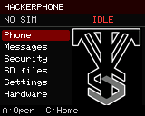
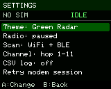

# HackerPhone — MakerPhone 2 engineering port

Independent MIT firmware for the owner's CircuitMess **MakerPhone 2 / MP24 engineering sample**, maintained in its own [HackerPhone repository](https://github.com/valleytechsolutions/HackerPhone). This is an early hardware bring-up, not a finished Marauder port or a validated daily-use telephone. A web flasher will follow hardware and recovery validation; none is published yet.

The original 4 MB flash has been saved privately before any replacement. This board has an ESP32-S3, 2 MB quad PSRAM, a 160×128 ST7735 panel, 23 keys, a Quectel EG91-NAX modem, and a working SD card under its original firmware. Original Ringo firmware targets different hardware.

 

Actual 160×128 framebuffer captures from the engineering sample, displayed at 2× size.

## Current engineering build: 0.2

- Nonblocking, bounded phone service: SIM and registration status, incoming call events, validated dial commands, SMS-submit encoding, command timeouts, and no automatic message retries.
- No-SIM is a normal idle state; it never causes a modem power-cycle loop.
- Native phone-service tests use synthetic UART transcripts. No real calls or SMS are transmitted by tests.
- BWM boot image and VTS home wallpaper use the owner's unchanged PNG originals.
- Physical keypad navigation, multi-tap text composition, passive Wi-Fi/BLE recon, RSSI hunt, CSV session logging, and SD file previews are in the engineering application.
- Four saved themes: VTS Red, Dragon, Green Radar, and Black & Gold. The home title is **HACKERPHONE**. Device-family colors stay consistent across themes.
- Security menu: radar, Wi-Fi access points, transmitting stations, probe requests, BLE devices, dwell-normalized channel observations, and disconnect/BLE-spam/SSID-conflict events. Wi-Fi-only, BLE-only, combined listening and channel lock are selectable.
- Buffered raw Wi-Fi or EAPOL-only PCAP recording to SD, with short-write/error handling and a read-only USB file exporter. See [toolkit controls](docs/TOOLKIT.md) for limits and timestamp meaning.
- Independently implemented BLE GATT discovery, reads, writes, subscriptions, notifications and tree export. Device connection requires selecting a live BLE target; characteristic writes use the USB console. Blocking BLE requests run in a separate worker so the keypad and modem continue to be serviced.
- Timed Wi-Fi/BLE beacon sessions and complete legacy BLE advertisement replay. Each session shows its state, stops after 15 seconds and can be stopped immediately. Advertisement replay uses this radio's address and does not clone a GATT service or pairing identity.
- Optional SD vendor lookup at `/hackerphone/oui.bin`, generated with the original MIT [database builder](tools/build_vendor_db.py). No ChimeraBLE database or GPL application code is included. Random/private BLE addresses are not assigned an OUI vendor.
- Dragon Detector's bounded parsers and signal filter are pinned to its 0.9.2 source. A device signature is evidence of a device family, not proof of malicious intent. RSSI is not a measured range or bearing.
- [Marauder inventory](docs/MARAUDER-SCOPE.md) tracks remaining toolkit work. This is not full Marauder/ChimeraBLE parity: deauthentication transmission, authentication/SAE/CSA attacks, captive portals, BLE MITM/GATT cloning, network service scans, phone audio and SMS inbox reading are still unfinished. The on-screen dial action remains gated until its voice audio path works.

## Build and test

Use Python 3.12 in a virtual environment and install `python -m pip install -r requirements-dev.txt`. This includes **pioarduino Core 6.2.0**, required by the pinned ESP32 platform; it provides the `platformio` Python module and `pio` command. The recipe also pins TFT_eSPI and NimBLE. `python tools/test_core.py` runs native tests without opening a serial port. `python -m platformio run -e mp24_sample` builds the engineering image.

The partition file matches this sample's saved layout. Development flashing must write **only the application at `0x10000`**, after verifying the connected chip, flash size, and recovery copy. Never use Ringo binaries, erase-flash, or the automatically generated `firmware.factory.bin` on this sample: its generic boot-app offset overlaps the saved NVS layout. The development procedure preserves the bootloader, partition table, NVS and SPIFFS. Normal runtime may update radio calibration/NVS and crash diagnostics. SD logging creates files only inside `/hackerphone`; no formatting is performed.

## Repository layout

| Directory | Contents |
|---|---|
| `firmware/` | Phone, display, keypad, recon, storage, BLE explorer and UI services |
| `assets/` | Owner-supplied BWM boot and VTS wallpaper originals |
| `tools/` | Native test runner, asset conversion, vendor database builder and USB exporter |
| `tests/` | Synthetic phone, protocol, storage and tracking checks |
| `docs/` | Hardware evidence, toolkit controls, feature inventory and validation results |
| `third_party/` | Pinned detector/decoder sources and license notices |

Local recovery images, captures and toolchains are excluded from Git. CI checks native services and compiles the engineering application; it does not flash hardware or publish a factory image.

## Controls

Joystick or A opens a menu item; C returns home and ends active transmissions/GATT connections; B goes back or erases text. Phone number entry uses the numeric keys and `*` for a leading `+`. Messages use traditional multi-tap typing (800 ms between different letters on one key), followed by a review screen. Radar's D button pauses listening. Target details lead to a signal hunt; D opens evidence, raw advertisement, connection and replay tools. A target being viewed is pinned against table eviction so a menu action cannot silently select its replacement. The SD browser previews the first 168 printable bytes and loads 32 entries per page; Left/Right moves between pages.

USB diagnostics and tools are documented in [TOOLKIT.md](docs/TOOLKIT.md). USB commands cannot place calls or send SMS; explicit `GATT` and `LAB` commands perform their named radio operations. Full flash backups, private logs, extracted engineering firmware, and radio captures stay in ignored `.work/` or on the device, never in a public repository.

## Verification still required

The user confirmed the physical panel and joystick/A navigation work. The application passes SD write/read tests and communicates with the modem in No-SIM mode. Combined Wi-Fi/BLE listening has run with stable memory and no queue drops. New-screen controls and daily power behavior still need acceptance testing; [validation notes](docs/VALIDATION.md) separate measured results from open checks. Cellular registration, calling, voice audio, and SMS delivery require a compatible activated SIM and live testing; none is claimed without that evidence. No SDK or schematic was provided with this engineering sample. Board assignments recovered from its diagnostics/image are documented with their evidence in [hardware notes](docs/MP24-HARDWARE.md).

[Credits and licensing](CREDITS.md).
