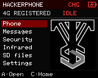
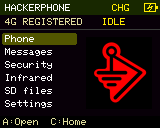
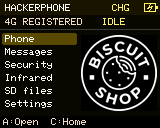
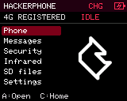

# Audio, buttons and notifications

HackerPhone 0.5 adds these controls to the MP24 engineering sample. Headphone
audio, MP3 playback, volume buttons, red-button lock/shutdown/wake, all eight LEDs
and the retro tone previews were confirmed by the owner. The 0.6 preview adds a PCM cellular voice bridge, with two-way speech confirmed
by the owner. Setup and remaining limits are in [cellular controls](CELLULAR.md).

## Side controls

- Volume up/down: 5% steps, with repeat after a half-second hold. The master level
  saves after 1.5 seconds without another change and also works while locked.
- Red button, short tap: screen/keypad lock or unlock. Music and passive recon
  continue. This is a pocket lock, not a PIN or encryption feature.
- Red button, hold 2.5 seconds: stop tools/music, flush logs and request modem
  shutdown, then release the hardware latch. Release the button to finish. USB can
  keep the board powered; the application then enters deep sleep and wakes on the
  red button. Physical battery-only latch operation still needs acceptance.

## Themes and home logos

Open **Settings → Theme** and press **A** to cycle the saved appearance. Press
**C** to return home and see its artwork. As in Dragon Detector, VTS Red uses
the VTS logo; Dragon, Green Radar and Black & Gold use BWM; Biscuit Shop and
Marauder have their supplied Biscuit and JCMK logos. The original four indices
are preserved, with the two new choices appended. The boot logo stays BWM.
The USB command `THEME 0` through `THEME 5` selects the same six choices.

<p>   </p>

Actual 160×128 framebuffer captures from the connected MP24 sample. The green
and black/gold variants also use BWM, matching Dragon Detector's original themes.

## Battery indicator

The top-right header contains a battery icon and **~N%** estimate on battery
power. At 10% or less it turns red. **USB** means external power is detected;
**CHG** means the charging-status input is active. **--** means a valid reading
is unavailable. Allow a few seconds for the indicator to settle after unplugging.

This engineering sample measures a shared supply rail. USB power can raise that
voltage above the battery's actual voltage, so no percentage is shown while USB
or charging is detected. The battery estimate is smoothed and voltage-based;
cell age, load and temperature affect accuracy. It is not a remaining-hours
estimate or a calibrated fuel gauge. The indicator does not change shutdown
behavior. Hardware details are in [the board notes](MP24-HARDWARE.md).

USB `BATTERY` reports ADC readiness, power source (`0` unknown, `1` battery,
`2` USB, `3` charging), measured rail millivolts, estimated percentage (`-1` when
unavailable) and low-battery state. Stale or invalid readings are never shown as
a full battery.
`BATTERY HISTORY` reads the most recent 32 samples retained in RAM, including
USB-host and charging inputs. This lets a developer inspect an unplug/replug
transition after reconnecting; it does not write diagnostics to SD.

## SD music player

Put MP3 files in `/hackerphone/music` or open an MP3 in the SD browser. The decoder
streams from SD using PSRAM buffers; it does not load the full track into flash.
Mono/stereo MP3 at 8–48 kHz is supported. Other codecs, DRM and Bluetooth audio are
not implemented. The headphone output was audibly verified with a test tone;
the decoder was exercised with an original stereo MP3 test fixture.

| Button in Music | Action |
|---|---|
| Up | Browse `/hackerphone/music` |
| A / joystick click | Pause/resume; replay the selected track after it stops |
| Left / Right | Previous/next MP3 in directory order, wrapping at the ends |
| D | Stop |
| # | Toggle repeat of the current track |
| C | Home; music keeps playing |

The player stops at the end of a track unless repeat is enabled. Next/previous
searches at most 1,024 directory entries. Notifications can interrupt music and
return to the same playback position; an incoming call pauses the music.

Upload without removing the card, with the device USB port selected explicitly:

```powershell
python tools/sd_upload.py --help
python tools/sd_upload.py --port COM58 track.mp3 /hackerphone/music/track.mp3
```

The uploader checks offsets, complete size and CRC32, writes a new `.part` file,
then renames it. It never overwrites an existing destination. Use a new filename
for a replacement, or use the SD file manager first. Transfers are intentionally
bounded and are slower than a card reader. Maximum file size is 64 MiB.

## Retro RTTTL notifications

Settings → Ringtones / RTTTL has independent call, text, recon and capture-saved
tones. A previews; Left/Right toggles a notification or changes alert volume.
The alert level multiplies the master level, so music and notifications can have
different loudness. Calls/texts are enabled by default; recon/tool tones are off.

The defaults are a short synthesized Mario opening for calls, the six-note
Power Rangers communicator motif for texts, and original recon/save chimes.
These are short note sequences, not recordings or full game soundtracks.
See [credits and rights](../CREDITS.md).

Load custom text files from `/hackerphone/tones/call.rtttl`, `sms.rtttl`,
`recon.rtttl` or `tool.rtttl` with the matching menu action. Valid tones save into
preferences and remain available without the card. A maximum of 8,192 bytes,
1,024 notes, ten minutes, octaves 3–8 and tempo 25–900 is accepted. For example:

```text
Saved:d=16,o=5,b=180:c,e,g,c6
```

An incoming call lets its complete alert finish before repeating, with at least a
one-second interval between starts. Answering or ending the call cancels playback.
Recon tone events have a ten-second cooldown. Long files load from SD; the USB
`TONE SET` line remains limited to 1,024 bytes of tune text. No full copyrighted
game theme is bundled. Supply your own RTTTL file to use a complete arrangement.

The owner described vibration only during sound playback. That is consistent
with speaker vibration; no independent motor control is identified in this
adapter. There is no claimed motor pulse setting or guessed GPIO assignment.

## LEDs

Settings → LEDs / notifications provides Off, Solid, Breathe and Chase patterns,
brightness, individual LED enable switches and call/text/recon/tool event toggles.
The test runs a five-second chase through all eight LEDs. Notifications use
distinct one-, two-, three- or four-pulse groups, then stop after five seconds.
Normal decorative patterns pause while locked; notification flashes still work.
All settings save locally. Updates touch only the identified LED channels.

## Audio and control USB commands

| Command | Action |
|---|---|
| `MUSIC`, `TONES`, `LEDS` | Open the corresponding screen |
| `MUSIC PLAY /hackerphone/music/track.mp3` | Queue a track |
| `MUSIC STATUS`, `MUSIC PAUSE`, `MUSIC STOP`, `MUSIC TEST` | Playback status/control or short output test |
| `VOLUME 0..100` | Saved master volume |
| `TONES STATUS` | Enabled mask, alert level and current RTTTL strings |
| `TONE PREVIEW 0..3`, `TONE RESET 0..3` | Preview or restore call/text/recon/tool |
| `TONE SET kind RTTTL`, `TONE LOAD kind /hackerphone/path.rtttl` | Validate and save a tone |
| `TONE ENABLE 0..15`, `TONE VOLUME 0..100` | Notification bitmask and alert level |
| `LEDS TEST`, `CONTROLS` | LED test or button/lock/audio readiness diagnostics |
| `LOCK`, `UNLOCK` | Pocket lock control; USB remains available |

Use the numeric argument, not the literal range notation `0..100`. File paths in
USB tools may contain ASCII spaces. Unicode paths can be browsed on the device,
but the USB command utility currently sends ASCII commands.
