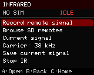

# Infrared on the MakerPhone 2 sample

Open **Infrared** from the home menu. This adapter targets the owner's transmit/receive expansion module and the recovered MP24 pin assignments; it is not a generic MakerPhone-module compatibility claim.



1. Choose **Record remote signal**, point the remote at the module, and press one button. Recording expires after ten seconds. A usable capture shows its pulse count.
2. Press **D** to save a new `.ir` recording to the SD card. No existing recording is overwritten. Without SD, the current signal remains in RAM until replaced or the phone restarts.
3. Press **A** on the selected signal to transmit once. **B** stops an active operation and returns to the IR menu; **C** stops it and returns home. Incoming phone activity also cancels IR.
4. Choose **Browse SD remotes** to open a file, then use **Left/Right** for its buttons. At most 32 previous button offsets are retained. An unsupported parsed protocol is labeled and can be skipped with Right.

The carrier menu cycles 36, 38, 40 and 56 kHz. Learning defaults to **38 kHz assumed**: it does not measure carrier frequency. Imported raw files retain their stated frequency and duty cycle. Changing the carrier also changes the current signal and marks it unsaved. Carrier selection currently resets on reboot.

## SD layout and formats

```text
/hackerphone/ir/
  recordings/    Newly learned raw signals, with unique filenames
  database/      User-supplied .ir libraries and subfolders
```

Libraries stay on the card. A buffered parser reads one button at a time into fixed signal buffers in PSRAM; it does not copy an entire database into flash or RAM. The existing file browser lists 32 entries per page. Names with spaces are supported. Folder traversal, control characters and oversized paths are rejected.

The independent MIT reader/writer follows the documented [Flipper `.ir` interchange format](https://github.com/flipperdevices/flipperzero-firmware/blob/dev/documentation/file_formats/InfraredFileFormats.md). No Flipper application code or third-party remote database is bundled. Retain the license and source notices of any database added to the card.

- Raw records: up to 1,024 alternating mark/space durations, 10–100 kHz carrier, 10–50% duty cycle, at most two seconds total. Learning ends at a roughly 30 ms idle gap; it captures one frame rather than an indefinite held button.
- Parsed imports: NEC, NECext, Samsung32, SIRC and SIRC15. Other parsed protocols are explicitly unsupported in this preview; use raw recordings for those devices. Protocol encoders have native checks, but appliance acceptance remains to be tested.
- Each record has a 64 KiB parsing budget. Malformed or oversized records are rejected. The parser runs one bounded record per request; SD latency can still delay that request.
- Saves use a new temporary file and rename it only after successful writes. A failed save leaves its `.tmp` file for inspection. This is not a guarantee against filesystem damage on sudden power loss.
- Entering Infrared stops radio tools and CSV recording. RMT channels and DMA buffers are allocated only during recording/transmission and released on completion, timeout or cancellation.

## USB controls

| Command | Action |
|---|---|
| `IR` | Open IR menu and stop radio tools |
| `IR RECORD`, `IR STOP` | Arm the receiver or cancel |
| `IR STATUS` | State, pulse count, carrier, record number and result |
| `IR OPEN /hackerphone/ir/database/Remote.ir` | Load the first button; never transmits |
| `IR NEXT`, `IR PREV` | Browse one button at a time |
| `IR FREQ 38000` | Set assumed carrier, 10–100 kHz |
| `IR SEND` | Transmit selected signal once |
| `IR SAVE`, `IR SAVE Living room power` | Save a new recording, optionally naming the button |
| `IR SELFTEST` | Write/read/remove a dedicated synthetic SD fixture; never transmits and refuses to discard an unsaved signal |

SD parser tests and receiver startup/timeout checks have passed on this sample. A successful RMT call alone does not establish optical reception, carrier accuracy, range or control of an appliance. Those remain physical acceptance checks.
